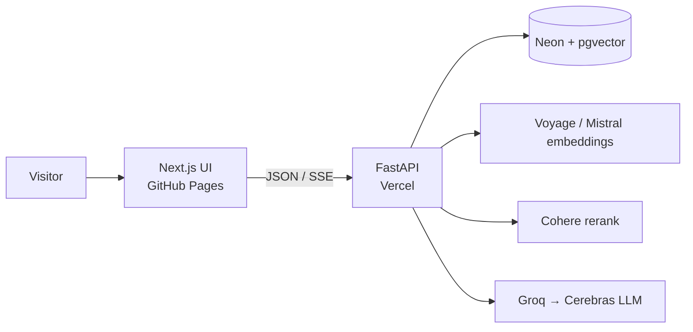

# Citefolio

**Ask your PDF. Answers cite the page.**

Upload a document, ask questions, get a streamed answer with page citations. Public portfolio RAG demo. Sessions last about two hours. No login.

[](https://mohabdelkarim.github.io/citefolio/)
[](https://citefolio-api.vercel.app/api/health)
[](LICENSE)

| | |
|---|---|
| **Demo** | https://mohabdelkarim.github.io/citefolio/ |
| **API** | https://citefolio-api.vercel.app |
| **Health** | https://citefolio-api.vercel.app/api/health |


## Why it exists

I wanted a RAG demo where you can see which page the answer came from. Hybrid search and rerank run on the API; the UI streams tokens and lists sources. Good enough as a portfolio piece, and usable as a small starter if you want citation-heavy PDF Q&A.

## Architecture



Rough pipeline: input checks → semantic cache → query rewrite / HyDE when needed → BM25 + pgvector (RRF) → retrieval checks → Cohere rerank → pack context → stream answer → output checks → cache / log.

Longer notes: [`docs/architecture.md`](docs/architecture.md).

## Stack

| Layer | Choice |
|-------|--------|
| UI | Next.js 15 (static export), React 19 |
| Hosting (web) | GitHub Pages |
| API | FastAPI on Vercel Python |
| DB | Neon Postgres + pgvector |
| Embeddings | Voyage (preferred) or Mistral |
| Rerank | Cohere |
| LLM | Groq primary, Cerebras fallback |

DB note: Neon Postgres + pgvector today. Same schema and retrieval SQL work on Supabase (also Postgres + `vector`) if you point `DATABASE_URL` there.

## Chunking strategy

Code: [`backend/app/core/chunker.py`](backend/app/core/chunker.py). Defaults in config: **512 tokens**, **15% overlap** (~77 tokens), tokenizer `cl100k_base`.

Recursive split prefers natural breaks in order: paragraph (`\n\n`), line (`\n`), sentence (`. `), word, then character. That keeps chunks readable for BM25 and embeddings instead of cutting mid-sentence when a cheaper fixed window would.

Each chunk stores `filename`, char offsets, and `estimated_page` (char position / ~3000). The UI cites that page estimate under answers. Real PDF page numbers would need a richer parser; this stays honest for text extraction.

## Evaluation

After each answer, RAGAs runs off the request path and writes scores to `query_logs`. Live thumbs go to `query_feedback` via `POST /api/feedback` (Yes = `1`, No = `-1`).

| Metric | What it checks | Where it lands |
|--------|----------------|----------------|
| Faithfulness | Is the answer grounded in the retrieved chunks? | `query_logs.faithfulness` |
| Answer relevancy | Does the answer address the question? | `query_logs.answer_relevancy` |
| Context precision | Were the retrieved chunks useful for that answer? | `query_logs.context_precision` |
| Human feedback | Visitor Yes / No on the demo | `query_feedback.rating` |

Helper: [`backend/app/utils/evaluation.py`](backend/app/utils/evaluation.py). No fixed leaderboard numbers in this README until a labeled sample set is checked in.

## Optimizations

Real tradeoffs in this demo, not a wish list:

- **Hybrid + RRF:** BM25 catches exact terms; pgvector catches paraphrase. RRF (`k=60`) merges ranks. The confidence guard uses **cosine similarity**, not RRF score, because fused ranks are tiny (~0.01) and would always fail a 0.25 threshold.
- **Rerank:** retrieve top 20, Cohere keeps top 5 before generation. Costs an API call; skips if Cohere is unset and falls back to RRF order.
- **Query transform:** rewrite / HyDE only when the pipeline decides the raw query needs help. Extra embed + LLM cost when used.
- **Semantic cache:** near-duplicate questions can reuse a prior answer (similarity threshold ~0.95).
- **No OCR / no local torch:** text PDFs only; Voyage or Mistral embeds. Fits Vercel size and cold-start limits; scanned PDFs fail instead of shipping a heavy model.
- **LLM failover:** Groq first, Cerebras if Groq is down or rate-limited.

## Repository layout

- `backend/`: FastAPI API for Vercel Python
- `web/`: Next.js App Router UI (Pages static export)
- `docs/`: architecture notes and demo screenshot
- `.github/workflows/pages_deploy.yml`: builds and deploys `web/`

## Quickstart

### 1. Neon

Create a Neon project, enable `vector`, run [`backend/app/db/schema.sql`](backend/app/db/schema.sql). Re-run that file after pulls that change RLS or policies.

### 2. Backend

```bash
cd backend
python -m venv .venv
# Windows: .venv\Scripts\activate
pip install -r requirements.txt
copy .env.example .env   # fill keys
uvicorn app.main:app --reload --port 8000
```

### 3. Web

```bash
cd web
npm install
copy .env.example .env.local
# NEXT_PUBLIC_API_URL=http://localhost:8000
npm run dev
```

Open http://localhost:3000

## Environment variables

See [`backend/.env.example`](backend/.env.example) and [`web/.env.example`](web/.env.example).

Required for a working demo:

- `DATABASE_URL`
- Embedding key: `VOYAGE_API_KEY` and/or `MISTRAL_API_KEY`
- `COHERE_API_KEY` (rerank; optional but recommended)
- `GROQ_API_KEY` (and ideally `CEREBRAS_API_KEY`)
- `CRON_SECRET`
- `CORS_ORIGINS` (include your web origin)
- `NEXT_PUBLIC_API_URL`

Never commit `.env` / `.env.local`.

## API

| Method | Path | Purpose |
|--------|------|---------|
| POST | `/api/session` | Create session |
| DELETE | `/api/session/{id}` | Destroy session + chunks |
| POST | `/api/upload` | multipart file + `session_id` |
| POST | `/api/query` | SSE stream: token / sources / done |
| POST | `/api/feedback` | rating `1` or `-1` |
| GET | `/api/health` | dependency status |
| GET/POST | `/api/cleanup` | cron cleanup (`Authorization: Bearer CRON_SECRET`) |

## Deploy considerations

1. **API (Vercel):** Root Directory `backend` → https://citefolio-api.vercel.app
2. **Web (GitHub Pages):** static export from `web/` via [`.github/workflows/pages_deploy.yml`](.github/workflows/pages_deploy.yml) → https://mohabdelkarim.github.io/citefolio/

Things that bite if you skip them:

- **Body size:** upload capped at **4MB** (Vercel request body). Larger files need a different upload path.
- **CORS:** set `CORS_ORIGINS` to include `https://mohabdelkarim.github.io` and local `http://localhost:3000`. Pages builds bake `NEXT_PUBLIC_API_URL=https://citefolio-api.vercel.app`.
- **Ephemeral sessions:** ~2h TTL, no login. Demo storage, not a long-lived knowledge base.
- **RLS:** document chunks use FORCE RLS keyed by `app.session_id`. Cleanup deletes **sessions** and relies on CASCADE; bare `DELETE FROM documents` under FORCE RLS is a no-op.
- **Cron:** Vercel Cron hits `/api/cleanup` daily ([`backend/vercel.json`](backend/vercel.json)). `CRON_SECRET` must not stay at `change_me`.
- **Managed APIs only:** embeddings, rerank, and LLM stay off-box so the Python function stays small enough for Vercel.

Repo social preview (GitHub UI): see [`.github/SOCIAL_PREVIEW.md`](.github/SOCIAL_PREVIEW.md).

## Contributing

See [`CONTRIBUTING.md`](CONTRIBUTING.md). Security reports: [`SECURITY.md`](SECURITY.md).

## License

[MIT](LICENSE)
