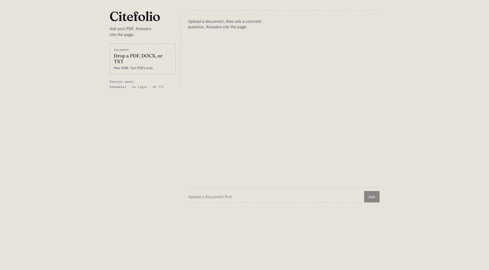
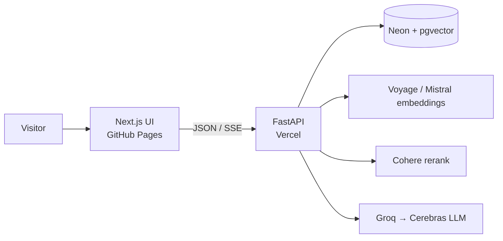

# Citefolio

**Ask your PDF. Answers cite the page.**

Public portfolio RAG demo: upload a document, ask questions, get streamed answers with page citations. Sessions are ephemeral (~2 hours). No login.

[](https://mohabdelkarim.github.io/citefolio/)
[](https://citefolio-api.vercel.app/api/health)
[](LICENSE)

| | |
|---|---|
| **Demo** | https://mohabdelkarim.github.io/citefolio/ |
| **API** | https://citefolio-api.vercel.app |
| **Health** | https://citefolio-api.vercel.app/api/health |



## Why it exists

Most RAG demos hide provenance. Citefolio is built to show the retrieval path: hybrid search, rerank, streamed answer, and citations tied to pages. Useful as a portfolio piece and as a starting point for citation-first document Q&A.

## Architecture



Pipeline: input guard → semantic cache → HyDE / rewrite / decompose → hybrid BM25 + pgvector (RRF) → retrieval guard → Cohere rerank → anti lost-in-middle context → stream answer → output guard → cache / log.

More detail: [`docs/architecture.md`](docs/architecture.md).

## Stack

| Layer | Choice |
|-------|--------|
| UI | Next.js 15 (static export), React 19 |
| Hosting (web) | GitHub Pages |
| API | FastAPI on Vercel Python |
| DB | Neon Postgres + pgvector |
| Embeddings | Voyage (preferred) or Mistral |
| Rerank | Cohere |
| LLM | Groq primary, Cerebras fallback |

## Repository layout

- `backend/` — FastAPI API for Vercel Python
- `web/` — Next.js App Router UI (Pages static export)
- `docs/` — architecture notes and demo screenshot
- `.github/workflows/pages_deploy.yml` — builds and deploys `web/`

## Quickstart

### 1. Neon

Create a Neon project, enable `vector`, run [`backend/app/db/schema.sql`](backend/app/db/schema.sql). Re-run that file after pulls that change RLS or policies.

### 2. Backend

```bash
cd backend
python -m venv .venv
# Windows: .venv\Scripts\activate
pip install -r requirements.txt
copy .env.example .env   # fill keys
uvicorn app.main:app --reload --port 8000
```

### 3. Web

```bash
cd web
npm install
copy .env.example .env.local
# NEXT_PUBLIC_API_URL=http://localhost:8000
npm run dev
```

Open http://localhost:3000

## Environment variables

See [`backend/.env.example`](backend/.env.example) and [`web/.env.example`](web/.env.example).

Required for a working demo:

- `DATABASE_URL`
- Embedding key: `VOYAGE_API_KEY` and/or `MISTRAL_API_KEY`
- `COHERE_API_KEY` (rerank; optional but recommended)
- `GROQ_API_KEY` (and ideally `CEREBRAS_API_KEY`)
- `CRON_SECRET`
- `CORS_ORIGINS` (include your web origin)
- `NEXT_PUBLIC_API_URL`

Never commit `.env` / `.env.local`.

## API

| Method | Path | Purpose |
|--------|------|---------|
| POST | `/api/session` | Create session |
| DELETE | `/api/session/{id}` | Destroy session + chunks |
| POST | `/api/upload` | multipart file + `session_id` |
| POST | `/api/query` | SSE stream: token / sources / done |
| POST | `/api/feedback` | rating `1` or `-1` |
| GET | `/api/health` | dependency status |
| GET/POST | `/api/cleanup` | cron cleanup (`Authorization: Bearer CRON_SECRET`) |

## Deploy

1. **API (Vercel)** — Root Directory `backend` → https://citefolio-api.vercel.app
2. **Web (GitHub Pages)** — static export from `web/` via [`.github/workflows/pages_deploy.yml`](.github/workflows/pages_deploy.yml) → https://mohabdelkarim.github.io/citefolio/

Set `CORS_ORIGINS` on the API to include `https://mohabdelkarim.github.io` (and local `http://localhost:3000`). Production Pages builds bake `NEXT_PUBLIC_API_URL=https://citefolio-api.vercel.app`.

Vercel Cron paths: [`backend/vercel.json`](backend/vercel.json).

Repo social preview (GitHub UI): see [`.github/SOCIAL_PREVIEW.md`](.github/SOCIAL_PREVIEW.md).

## Limits (v1)

- Max upload 4MB (Vercel request body limit)
- No OCR for scanned PDFs (text extractable docs only)
- Managed embeddings / rerank (no local torch models)
- Ephemeral sessions (~2h); not a production knowledge base

## Contributing

See [`CONTRIBUTING.md`](CONTRIBUTING.md). Security reports: [`SECURITY.md`](SECURITY.md).

## License

[MIT](LICENSE)
